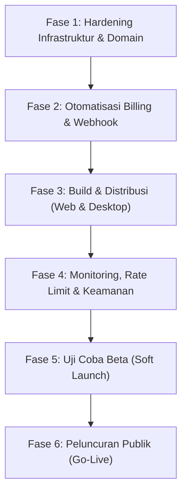
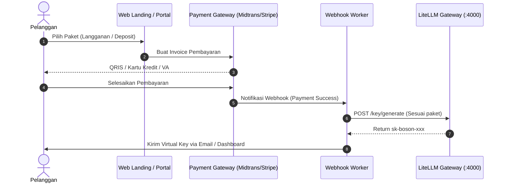

# Roadmap & Rencana Aksi Menuju Production (Boson Studio)

Dokumen ini memetakan peta jalan (*roadmap*) menyeluruh dari tahap pengembangan lokal saat ini menuju peluncuran aplikasi siap produksi (**Production-Ready Enterprise / SaaS**).

---

## 1. Timeline & Fase Peluncuran



---

## 2. Rincian Setiap Fase

### FASE 1: Hardening Infrastruktur & Jaringan (Minggu 1)
> [!IMPORTANT]
> Mengamankan port internal agar tidak pernah bocor ke internet publik dan menyiapkan domain SSL resmi.

- [ ] **Alokasi Server VPS/Cloud**:
  - Rekomendasi spesifikasi minimal: 2 vCPU, 4GB RAM, 50GB NVMe SSD (Ubuntu 24.04 LTS).
  - Provider: Hetzner, DigitalOcean, AWS EC2, atau GCP Compute Engine.
- [ ] **Konfigurasi Domain & DNS**:
  - `app.boson.ai` (atau domain Anda) $\rightarrow$ Mengarah ke IP server Frontend Boson Studio.
  - `api.boson.ai` $\rightarrow$ Mengarah ke IP server Backend LiteLLM Gateway.
- [ ] **Setup Reverse Proxy & Auto-SSL (Caddy / Nginx)**:
  - Aktifkan file [`gateway/Caddyfile`](gateway/Caddyfile).
  - Pastikan port `4000` (LiteLLM) dan `5432` (PostgreSQL) hanya mengikat ke `127.0.0.1`.
  - Pasang firewall host (`ufw allow 80`, `ufw allow 443`, `ufw default deny incoming`).
- [ ] **Backup Database Rutin**:
  - Buat cron job harian untuk mencadangkan database PostgreSQL ke Cloud Storage (S3 / R2 / GCS):
    ```bash
    0 2 * * * docker compose -f /path/to/gateway/docker-compose.yml exec -T db pg_dump -U litellm litellm | gzip > /backup/db_$(date +\%F).sql.gz
    ```

---

### FASE 2: Otomatisasi Payment Gateway & Webhook (Minggu 2)
> [!TIP]
> Mengotomatiskan pembuatan Virtual Key tanpa perlu input manual di CLI saat pelanggan membayar.



- [ ] **Pilih Payment Gateway**:
  - *Indonesia*: Midtrans, Xendit, atau Duitku (mendukung QRIS, VA Bank, GoPay/OVO).
  - *Global*: Stripe atau Lemon Squeezy (mendukung kartu kredit internasional & langganan recurring).
- [ ] **Buat Service Webhook Ringan (`server-billing`)**:
  - Endpoint `POST /api/webhook/payment`:
    - Validasi signature webhook dari payment gateway.
    - Jika paket adalah **Langganan Bulanan**: Panggil endpoint LiteLLM `/key/generate` dengan `budget_duration: "30d"` dan `max_budget: X`.
    - Jika paket adalah **Deposit Berjangka**: Panggil endpoint `/key/generate` dengan `duration: "30d"` atau `duration: "90d"`.
    - Jika paket adalah **Top-up Saldo**: Panggil endpoint `/key/update` dengan penambahan budget.
- [ ] **Tautkan Key ke Akun Pengguna**:
  - Simpan mapping: `userId` $\leftrightarrow$ `email` $\leftrightarrow$ `virtualKey` di database aplikasi.

---

### FASE 3: Build & Distribusi Aplikasi (Minggu 3)

#### A. Versi Web (SaaS)
- [ ] **Build Production Artifacts**:
  ```bash
  pnpm run build
  ```
- [ ] **Process Management**:
  - Jalankan layanan web menggunakan `systemd` atau `PM2` agar otomatis menyala kembali jika server reboot:
    ```bash
    pm2 start "node --import tsx/esm apps/cli/src/bin.ts web --no-open --port 3080" --name boson-web
    pm2 save
    pm2 startup
    ```

#### B. Versi Desktop (Windows, macOS, Linux)
- [ ] **Package Desktop App**:
  - Build executable mandiri untuk distribusi installer desktop.
  - Tambahkan konfigurasi default URL yang mengarah ke `https://api.yourdomain.com/v1`.
- [ ] **Code Signing Certificate (Opsional tapi Direkomendasikan)**:
  - Sertifikat tanda tangan digital agar installer tidak ditandai sebagai *Unknown Publisher* / SmartScreen oleh Windows & Apple Gatekeeper.

---

### FASE 4: Observability, Abuse Prevention & Rate Limiting (Minggu 4)

- [ ] **Rate Limiting & Anti-Spam**:
  - Terapkan limit permintaan per menit (RPM) dan token per menit (TPM) pada `gateway/config.yaml` agar tidak ada pengguna yang membombardir sistem secara berlebihan:
    ```yaml
    general_settings:
      user_rpm_limit: 60
      user_tpm_limit: 100000
    ```
- [ ] **Alerting Saldo OpenRouter**:
  - Pasang webhook / bot notifikasi (Telegram / Discord / Slack) yang otomatis memperingatkan Anda jika saldo kredit akun OpenRouter utama Anda tersisa di bawah \$20.
- [ ] **Dashboard Admin**:
  - Akses UI bawaan LiteLLM Admin di `http://127.0.0.1:4000/ui` menggunakan `LITELLM_MASTER_KEY` untuk memantau grafik konsumsi token, pengguna teratas, dan audit log secara visual.

---

### FASE 5 & 6: Uji Coba Beta & Peluncuran Resmi (Go-Live)

- [ ] **Uji Coba Beta Tertutup (5–10 Pengguna Awal)**:
  - Uji seluruh alur: pendaftaran $\rightarrow$ pembayaran $\rightarrow$ pemakaian di Boson Studio $\rightarrow$ saldo habis $\rightarrow$ top-up.
  - Verifikasi keakuratan pemotongan saldo deposit dan kalkulasi profit margin (+25% s/d +30%).
- [ ] **Halaman Legal & Ketentuan**:
  - Siapkan *Terms of Service* (ToS) yang mencakup kebijakan penggunaan AI dan kebijakan saldo/kuota (misal: saldo deposit tidak dapat diuangkan kembali).
  - Siapkan *Privacy Policy*.
- [ ] **Public Launch**:
  - Buka pendaftaran untuk umum.
  - Pantau beban CPU/RAM server pada hari pertama.

---

## 3. Matriks Kesiapan (Readiness Checklist)

| Komponen | Status Saat Ini | Kebutuhan Menuju Produksi |
| :--- | :---: | :--- |
| **White Label Branding** | ✅ Selesai | Sudah menjadi Boson Studio |
| **Gateway Proxy & Markup** | ✅ Selesai | Siap di `gateway/` (+25-30% margin) |
| **Origin Whitelisting** | ✅ Selesai | Mengunci akses domain resmi |
| **Masa Hangus & Reset Bulanan**| ✅ Selesai | Terverifikasi di `manage-tenant.ts` |
| **Server & Domain SSL** | ⏳ Menunggu Deploy | Beli VPS & arahkan DNS domain |
| **Integrasi Payment Gateway** | ⏳ Menunggu Setup | Integrasikan webhook Midtrans/Stripe |
| **Auto-Restart (PM2/Systemd)**| ⏳ Menunggu Setup | Pasang script process supervisor |
