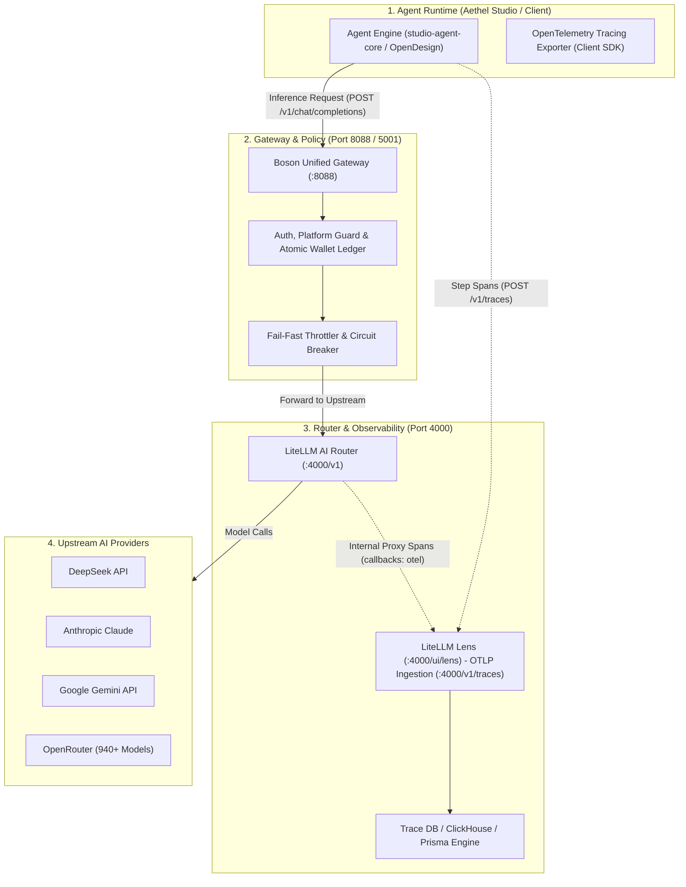

# 📡 Standar Endpoint AI Gateway & Observability Tracing (LiteLLM Lens & Boson)

Dokumen ini adalah **spesifikasi teknis resmi (Technical Integration & Telemetry Specification)** untuk agen AI dan developer backend/frontend. Dokumen ini mendefinisikan standar endpoint inferensi, ingest tracing OpenTelemetry (OTLP) ke **LiteLLM Lens**, skema data input/output, serta tata kelola propagasi identitas pada ekosistem **Boson AI SaaS & Aethel Studio**.

---

## 1. Topologi Arsitektur & Observability



---

## 2. Katalog Endpoint Resmi & Portal Manajemen

### A. Endpoint Observability & Tracing (LiteLLM Lens)
| Nama Endpoint | Protokol / Method | URL Resmi | Fungsi Utama |
| :--- | :--- | :--- | :--- |
| **OTLP Trace Ingest** | `POST` (JSON / Protobuf) | `http://127.0.0.1:4000/v1/traces` | Menerima data span & trace OpenTelemetry dari Agent. |
| **OTLP Log Ingest** | `POST` (JSON) | `http://127.0.0.1:4000/v1/logs` | Menerima log eksekusi dan error runtime agen. |
| **Lens Dashboard UI** | Web Interface (HTTP) | `http://127.0.0.1:4000/ui/lens/?tab=home` | Portal UI untuk investigasi trace, latency, dan analisis kegagalan agen. |
| **Lens Traces Explorer**| Web Interface (HTTP) | `http://127.0.0.1:4000/ui/lens/?tab=traces` | Melihat daftar run, step tool call, token cost, dan waterfall latency. |

### B. Endpoint Inferensi Model (Boson Unified Gateway)
| Nama Endpoint | Protokol / Method | URL Resmi | Deskripsi |
| :--- | :--- | :--- | :--- |
| **Chat Completions** | `POST` (SSE / Stream) | `http://127.0.0.1:8088/v1/chat/completions` | Standar OpenAI API untuk Aethel Studio, Cursor, CLI, dan agen coding. |
| **Anthropic Messages**| `POST` (SSE / Stream) | `http://127.0.0.1:8088/v1/messages` | Standar Anthropic Claude Messages API (native Claude dialect). |
| **Models Catalog** | `GET` | `http://127.0.0.1:8088/v1/models` | Daftar model aktif beserta harga modal dan margin. |
| **Preflight Quota** | `GET` | `http://127.0.0.1:8088/api/v1/workspaces/:id/billing/preflight` | Pemeriksaan saldo sebelum agen memulai run panjang. |

---

## 3. Standar Header & Autentikasi

Setiap request dari Agen wajib menyertakan identitas terstruktur agar trace dan biaya terhubung secara konsisten ke user dan project:

```http
Authorization: Bearer <API_KEY_ATAU_SESSION_TOKEN>
X-Boson-Platform-Id: aethel-studio
X-Boson-Trace-Id: trace_7f2b1c4e9d3a4e10b7512803
X-Project-Id: proj_abc123
X-Run-Id: run_987xyz
Content-Type: application/json
```

- **Inference Auth (`Authorization`)**: Menerima Personal API Key (`sk_boson_...` / `sk_aethel_...`), PKCE Auth Token, atau `studio-local-token` untuk runner lokal.
- **Trace Ingestion Auth**: Endpoint `/v1/traces` dapat menggunakan header `Authorization: Bearer <LENS_TRACING_KEY>` atau diteruskan tanpa token jika diatur internal private network.

---

## 4. Spesifikasi Data Input & Output Inferensi (OpenAI Compatible)

### A. Data Input (`POST /v1/chat/completions`)

```json
{
  "model": "deepseek-chat",
  "messages": [
    {
      "role": "system",
      "content": "You are Aethel Studio design-to-code agent. Build accessible HTML/CSS."
    },
    {
      "role": "user",
      "content": "Buatkan landing page modern untuk agensi desain."
    }
  ],
  "tools": [
    {
      "type": "function",
      "function": {
        "name": "Write",
        "description": "Writes code to a file in workspace",
        "parameters": {
          "type": "object",
          "properties": {
            "file_path": { "type": "string" },
            "content": { "type": "string" }
          },
          "required": ["file_path", "content"]
        }
      }
    }
  ],
  "tool_choice": "auto",
  "temperature": 0.2,
  "stream": true,
  "stream_options": { "include_usage": true }
}
```

### B. Data Output Streaming (`text/event-stream`)

Format stream berupa Server-Sent Events (SSE) berurutan:

```
data: {"id":"chatcmpl-123","object":"chat.completion.chunk","created":1792600000,"model":"deepseek-chat","choices":[{"index":0,"delta":{"role":"assistant","content":""},"finish_reason":null}]}

data: {"id":"chatcmpl-123","object":"chat.completion.chunk","created":1792600000,"model":"deepseek-chat","choices":[{"index":0,"delta":{"tool_calls":[{"index":0,"id":"call_write_01","type":"function","function":{"name":"Write","arguments":"{\"file_path\":\"index.html\""}}]}}]}

data: {"id":"chatcmpl-123","object":"chat.completion.chunk","created":1792600000,"model":"deepseek-chat","choices":[{"index":0,"delta":{"tool_calls":[{"index":0,"function":{"arguments":",\"content\":\"<!DOCTYPE html><html>...\"}"}}]},"finish_reason":null}]}

data: {"id":"chatcmpl-123","object":"chat.completion.chunk","created":1792600000,"model":"deepseek-chat","choices":[{"index":0,"delta":{},"finish_reason":"tool_calls"}]}

data: {"id":"chatcmpl-123","object":"chat.completion.chunk","created":1792600000,"model":"deepseek-chat","choices":[],"usage":{"prompt_tokens":350,"completion_tokens":120,"total_tokens":470}}

data: [DONE]
```

### C. Error Contract (Fail-Fast)
Jika terjadi kegagalan saldo atau limit, Gateway mengembalikan format terstandarisasi:

```json
{
  "error": {
    "code": "insufficient_quota",
    "status": 402,
    "message": "Saldo akun tidak mencukupi untuk melakukan inferensi model deepseek-chat.",
    "upgrade_url": "http://127.0.0.1:8088/pricing"
  }
}
```

---

## 5. Spesifikasi Tracing OpenTelemetry untuk Lens (`POST /v1/traces`)

Agen AI dapat mengirimkan data span eksekusi langsung ke endpoint **LiteLLM Lens** (`http://127.0.0.1:4000/v1/traces`) menggunakan format standar **OTLP/HTTP JSON**.

### A. Struktur Data Input OTLP Payload

```json
{
  "resourceSpans": [
    {
      "resource": {
        "attributes": [
          { "key": "service.name", "value": { "stringValue": "aethel-studio-agent" } },
          { "key": "service.version", "value": { "stringValue": "0.25.1" } },
          { "key": "deployment.environment", "value": { "stringValue": "production" } }
        ]
      },
      "scopeSpans": [
        {
          "scope": {
            "name": "aethel.agent.runtime",
            "version": "1.0.0"
          },
          "spans": [
            {
              "traceId": "4bf92f3577b34da6a3ce929d0e0e4736",
              "spanId": "00f067aa0ba902b7",
              "parentSpanId": "",
              "name": "agent.turn.execution",
              "kind": 1,
              "startTimeUnixNano": "1792600000000000000",
              "endTimeUnixNano": "1792600004500000000",
              "attributes": [
                { "key": "gen_ai.system", "value": { "stringValue": "boson-gateway" } },
                { "key": "gen_ai.request.model", "value": { "stringValue": "deepseek-chat" } },
                { "key": "gen_ai.usage.prompt_tokens", "value": { "intValue": "350" } },
                { "key": "gen_ai.usage.completion_tokens", "value": { "intValue": "120" } },
                { "key": "user.id", "value": { "stringValue": "usr_7094de66" } },
                { "key": "project.id", "value": { "stringValue": "proj_design_01" } },
                { "key": "run.id", "value": { "stringValue": "run_15522051" } }
              ],
              "status": { "code": 1 }
            },
            {
              "traceId": "4bf92f3577b34da6a3ce929d0e0e4736",
              "spanId": "5fb397be34d23b0f",
              "parentSpanId": "00f067aa0ba902b7",
              "name": "agent.tool.call",
              "kind": 3,
              "startTimeUnixNano": "1792600002100000000",
              "endTimeUnixNano": "1792600003200000000",
              "attributes": [
                { "key": "gen_ai.tool.name", "value": { "stringValue": "Write" } },
                { "key": "gen_ai.tool.input", "value": { "stringValue": "{\"file_path\":\"index.html\"}" } },
                { "key": "gen_ai.tool.status", "value": { "stringValue": "success" } }
              ],
              "status": { "code": 1 }
            }
          ]
        }
      ]
    }
  ]
}
```

### B. Standar Atribut Semantik (Semantic Conventions)

Untuk memastikan data terbaca dengan rapi di grafik **Lens Traces Explorer**, gunakan kunci atribut berikut:

| Kunci Atribut | Tipe Data | Deskripsi |
| :--- | :--- | :--- |
| `gen_ai.system` | `string` | Nama gateway (`boson-gateway`, `litellm`). |
| `gen_ai.request.model` | `string` | Model yang diminta (`deepseek-chat`, `gemini-3.5-flash`). |
| `gen_ai.usage.prompt_tokens` | `int` | Jumlah token prompt input. |
| `gen_ai.usage.completion_tokens` | `int` | Jumlah token jawaban model. |
| `gen_ai.tool.name` | `string` | Nama tool yang dipanggil (`Write`, `Edit`, `Bash`, `TodoWrite`). |
| `gen_ai.tool.status` | `string` | Status eksekusi tool (`success`, `failed`). |
| `user.id` | `string` | ID user pemilik sesi (dari token JWT/API Key). |
| `project.id` | `string` | ID project workspace. |
| `run.id` | `string` | ID unik proses run. |

### C. Data Output Ingestion
Jika span valid, Lens merespons dengan:
```json
{
  "status": "success",
  "spans_received": 2
}
```

---

## 6. Panduan Implementasi untuk Agent (TypeScript)

Berikut adalah modul pembantu (*helper module*) yang dapat langsung diimpor ke agent runner (`studio-agent-core` / OpenDesign daemon):

```typescript
import { randomBytes } from 'node:crypto';

export interface TraceContext {
  traceId: string;
  parentSpanId?: string;
  userId: string;
  projectId: string;
  runId: string;
}

export function createTraceContext(userId: string, projectId: string, runId: string): TraceContext {
  return {
    traceId: randomBytes(16).toString('hex'),
    userId,
    projectId,
    runId,
  };
}

export async function sendLensTrace(
  ctx: TraceContext,
  spanName: string,
  startTimeMs: number,
  endTimeMs: number,
  attributes: Record<string, string | number>,
  isError = false
): Promise<void> {
  const spanId = randomBytes(8).toString('hex');
  const endpoint = process.env.LENS_TRACE_ENDPOINT || 'http://127.0.0.1:4000/v1/traces';

  const payload = {
    resourceSpans: [
      {
        resource: {
          attributes: [
            { key: 'service.name', value: { stringValue: 'aethel-studio-agent' } },
            { key: 'user.id', value: { stringValue: ctx.userId } },
            { key: 'project.id', value: { stringValue: ctx.projectId } },
            { key: 'run.id', value: { stringValue: ctx.runId } },
          ],
        },
        scopeSpans: [
          {
            scope: { name: 'aethel.agent' },
            spans: [
              {
                traceId: ctx.traceId,
                spanId,
                parentSpanId: ctx.parentSpanId || '',
                name: spanName,
                startTimeUnixNano: (BigInt(startTimeMs) * 1_000_000n).toString(),
                endTimeUnixNano: (BigInt(endTimeMs) * 1_000_000n).toString(),
                attributes: Object.entries(attributes).map(([key, val]) => ({
                  key,
                  value: typeof val === 'number' ? { intValue: val } : { stringValue: String(val) },
                })),
                status: { code: isError ? 2 : 1 },
              },
            ],
          },
        ],
      },
    ],
  };

  try {
    await fetch(endpoint, {
      method: 'POST',
      headers: { 'Content-Type': 'application/json' },
      body: JSON.stringify(payload),
    });
  } catch (err) {
    // Non-blocking telemetry failure
    console.warn('[Telemetry] Gagal mengirim trace ke Lens:', err);
  }
}
```

---

## 7. Konfigurasi Otomatis di `litellm-config.yaml`

Agar setiap pemanggilan inferensi yang melalui LiteLLM otomatis masuk ke LiteLLM Lens tanpa coding manual di tiap endpoint, tambahkan callback `otel` pada [`litellm-config.yaml`](./litellm-config.yaml):

```yaml
model_list:
  - model_name: deepseek-chat
    litellm_params:
      model: deepseek/deepseek-chat
      api_key: os.environ/DEEPSEEK_API_KEY

litellm_settings:
  callbacks: ["otel"] # Mengaktifkan OpenTelemetry otomatis
  success_callback: ["otel"]
  failure_callback: ["otel"]

router_settings:
  routing_strategy: "least-busy"
  num_retries: 1
  timeout: 20
  cooldown_time: 300

general_settings:
  master_key: os.environ/LITELLM_MASTER_KEY
```

Dan pastikan environment variable berikut terpasang di container LiteLLM:
```env
LITELLM_OTEL_V2=true
OTEL_EXPORTER_OTLP_PROTOCOL=http/json
OTEL_EXPORTER_OTLP_ENDPOINT=http://127.0.0.1:4000
```

---

## 8. Integrasi Aethel Studio (`open-design`) & Tracing Propagasi

Runtime agen native Aethel Studio (`studio-agent-core` berbasis Codex-RS) telah terintegrasi penuh secara dual-layer:

### A. Layer 1: Injeksi Header Propagasi & Metadata Inferensi
Pada setiap peluncuran run ([`apps/daemon/src/runtimes/defs/studio-agent-core.ts`](file:///var/home/fazdev/open-design/apps/daemon/src/runtimes/defs/studio-agent-core.ts)), argumen provider HTTP menyertakan identitas trace:
```bash
-c 'model_providers.custom_gateway.http_headers={"X-Aethel-Platform-Id"="aethel-studio","X-Boson-Platform-Id"="aethel-studio","X-Aethel-Trace-Id"="<trace_id>","X-Boson-Trace-Id"="<trace_id>"}'
```
Boson Gateway memverifikasi platform (`X-Aethel-Platform-Verified: aethel-studio`) dan mengembalikan `X-Aethel-Trace-Id` pada header respons. Metadata `user_id`, `user_email`, `platform_id`, dan `trace_id` diteruskan ke LiteLLM untuk pencatatan span terpadu.

### B. Layer 2: OpenTelemetry OTLP Exporter Otomatis
`studio-agent-core` mengekspor span eksekusi langsung ke endpoint OTLP:
```bash
-c 'otel.trace_exporter={otlp-http={endpoint="http://127.0.0.1:4000/v1/traces",protocol="json"}}'
-c 'otel.environment="aethel-studio"'
-c 'otel.log_user_prompt=true'
-c 'otel.log_agent_responses=true'
-c 'otel.span_attributes={"service.name"="aethel-studio","platform.id"="aethel-studio"}'
```
Environment process child mewarisi:
- `OTEL_EXPORTER_OTLP_ENDPOINT=http://127.0.0.1:4000`
- `OTEL_EXPORTER_OTLP_TRACES_ENDPOINT=http://127.0.0.1:4000/v1/traces`
- `OTEL_SERVICE_NAME=aethel-studio`
- `OTEL_RESOURCE_ATTRIBUTES="service.name=aethel-studio,platform=aethel-studio"`

### C. Layer 3: OTLP Trace Proxy pada Boson Gateway (:8088)
Untuk klien yang hanya memiliki akses ke port gateway `8088`, Boson Gateway menyediakan proxy transparan:
- `POST http://127.0.0.1:8088/v1/traces`
- `POST http://127.0.0.1:8088/api/public/otel/v1/traces`
- `POST http://127.0.0.1:8088/v1/logs`
Semua span yang diterima diteruskan secara asinkron ke LiteLLM upstream dan mengembalikan `HTTP 200 OK` tanpa memblokir runtime agen.

