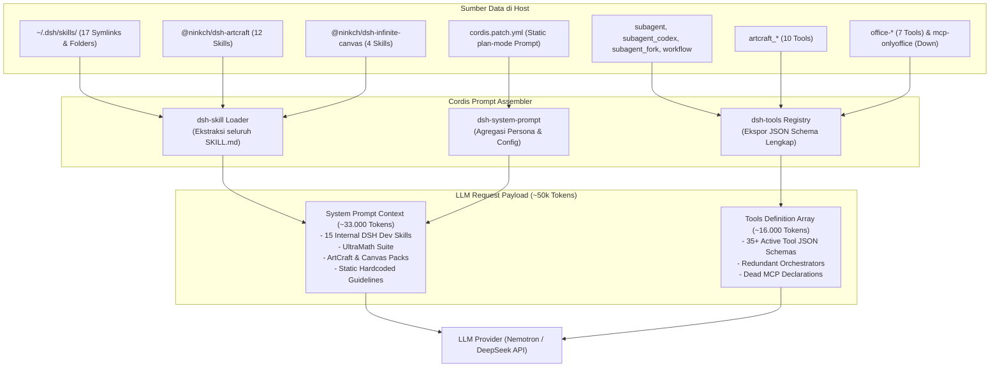

# Dokumen Analisa Teknis: Bottleneck Token Input (50k Token Bloat)

## 1. Ringkasan Eksekutif

Pada evaluasi runtime profil Web DeepSeek Harness (`~/.dsh/profiles/web/`), terdeteksi bahwa **baseline token input pada setiap giliran awal (turn 0) mencapai ~48.000 hingga 52.000 token**.

Kondisi ini menciptakan *overhead* kritis terhadap sistem:
* **Latensi Eksekusi (TTFT):** Waktu komputasi awal (*Time-To-First-Token*) melonjak drastis (3–8 detik) karena model harus memproses 50k token sebelum mengevaluasi instruksi pengguna.
* **Degradasi Pemilihan Tool (*Tool Attention Confusion*):** Terdapat tumpang tindih (*overlap*) fungsional antara cluster tool delegasi (`subagent` vs `workflow`) yang membingungkan *attention mechanism* model.
* **Pemborosan Context Window:** Menyita lebih dari 50% hingga 80% dari kapasitas *context window* efektif model sebelum riwayat pesan dimulai.

---

## 2. Diagram Alur Injeksi Token Prompt

Berikut diagram arsitektur perakitan (*prompt assembly*) di DeepSeek Harness / Cordis loop yang memicu pembengkakan token:



---

## 3. Distribusi Beban Token (Token Budget Breakdown)

Berdasarkan audit telemetri dan struktur payload, berikut pembagian beban token input:

| Sub-Sistem / Komponen | Jumlah Definisi | Mekanisme Injeksi | Estimasi Beban (Token) | Kontribusi Relatif |
|---|---|---|---|---|
| **Skill Leakage (DSH Internal Dev)** | 15 Skills | Injeksi teks Markdown `SKILL.md` ke System Prompt | ~14.500 | **29.0%** |
| **Domain Skill: UltraMath Research** | 1 Suite (Multi-Agent) | Injeksi Markdown & Gate Specs ke System Prompt | ~6.500 | **13.0%** |
| **Domain Skill: ArtCraft & Canvas** | 16 Skills | Injeksi teks Markdown ke System Prompt | ~8.000 | **16.0%** |
| **Domain Skill: Office Suite** | 7 Skills | Injeksi deskripsi skenario Office | ~2.500 | **5.0%** |
| **Tool Cluster: Orkestrasi Sub-Agent** | 4 Tools | JSON Schema (`subagent`, `subagent_codex`, `subagent_fork`, `workflow`) | ~5.200 | **10.4%** |
| **Tool Cluster: ArtCraft Suite** | 10 Tools | JSON Schema API & CLI bridges | ~4.500 | **9.0%** |
| **Tool Cluster: Office & LSP** | 11 Tools | JSON Schema Office kit & Language Servers | ~4.800 | **9.6%** |
| **Static Injection (cordis.patch.yml)** | 1 Blok Raksasa | Hardcoded section `plan-mode` (20 baris kapital) | ~1.200 | **2.4%** |
| **Framework Base Prompt & Formatting** | Standar | Aturan dasar output markdown & tooling | ~2.800 | **5.6%** |
| **TOTAL BASELINE (Turn 0)** | **-** | **Payload Bersih Sebelum Pesan Pengguna** | **~50.000** | **100.0%** |

---

## 4. Analisa Teknis Akar Masalah (Root Causes)

### A. "Skill Leakage" dari Symlink Internal Developer
* **Mekanisme:** Plugin `@deepseek-ai/dsh-skill` memindai seluruh direktori `~/.dsh/skills/` dan mengekstrak blok `name`, `description`, serta aturan operasional setiap file `SKILL.md`.
* **Akar Masalah:** Di lingkungan lokal ini, direktori `~/.dsh/skills/` berisi symlink langsung ke `.agents/skills/` repositori pengembang DeepSeek Harness:
  * `dsh-pre-push-checks`, `dsh-merging-stacked-prs`, `dsh-ci-test-reliability`, `dsh-prose-standard`, `dsh-translate-docs`, `dsh-client-ui-ux`, `dsh-error-handling`, `dsh-speed-up-perf`, `dsh-trim-cot-leakage`, dll.
* **Dampak:** Skill-skill ini adalah aturan kerja internal tim pengembang untuk melakukan *pull request* di GitHub. Mereka sama sekali tidak relevan dengan sesi percakapan umum, namun tetap disuntikkan secara membabi buta ke dalam prompt setiap detik.

### B. Tabrakan Konseptual: `Sub-agent` vs `Workflow Orchestration`
* **Mekanisme:** Profil Web memuat 2 paradigma orkestrasi yang bersaing secara bersamaan:
  1. **Direct Delegation (`dsh-tool-subagent`):** Model memanggil `subagent` untuk mendelegasikan tugas independen ke satu anak proses.
  2. **Workflow Scripting (`dsh-tool-workflow`):** Model menulis kode JavaScript untuk orkestrasi paralel (*fan-out*) subagent.
  3. **Varian Proses Tambahan:** `subagent_codex` dan `subagent_fork` ikut didaftarkan sebagai tool mandiri.
* **Dampak:**
  * Keempat tool tersebut masing-masing memiliki parameter JSON Schema yang sangat kompleks (struktur konfigurasi anak, *depth control*, batas waktu, format data balik).
  * Terjadi *tool conflict* di mana model ragu apakah harus mengeksekusi sub-task langsung via `subagent` atau membuat skrip `workflow`.

### C. Redundansi Integrasi Office (Triple Provider)
Terdapat 3 implementasi pengolah dokumen Office yang berjalan bersamaan:
1. `dsh-office-tools` (paket npm di `package.json`): Menyuntikkan 7 tool (`office`, `office-docx`, `office-pptx`, `office-xlsx`, `office-recalculate`, `office-render`, `office-export-pdf`).
2. `@deepseek-ai/dsh-skill-office` (di `cordis.patch.yml`): Menyuntikkan skill manipulasi office bawaan.
3. `mcp-onlyoffice` (di `cordis.patch.yml`): Deklarasi konektor stdio ke ONLYOFFICE DocSpace di `http://localhost:8092`.
   > **Fakta Teknis:** Port `8092` berstatus **CLOSED / DOWN** dan `DOCSPACE_API_KEY` bernilai string kosong `""`. Tool ini mati tetapi tetap didefinisikan dalam patch tree.

### D. Blok Hardcoded Statis di `cordis.patch.yml`
* Blok konfigurasi `plan-mode` (baris 130–149) memuat teks instruksi 20 baris kapital redundan:
  ```yaml
  - id: plan-mode
    config:
      section: |
        CRITICAL INSTRUCTION: You are in PLAN MODE.
        DO NOT print or paste the plan as a plain conversational chat reply...
  ```
  Teks ini memakan jatah token secara konstan dan tidak fleksibel.

---

## 5. Proyeksi Penurunan Token Pasca-Optimasi

Berikut simulasi perbandingan konsumsi token sebelum dan sesudah perampingan:

```mermaid
xychart-beta
    title "Perbandingan Konsumsi Token Input: Sebelum vs Sesudah Optimasi"
    x-axis ["Total Baseline", "Skills Injected", "Tools Schema", "Static Config"]
    y-axis "Token Count" 0 --> 55000
    bar [50000, 31500, 15500, 3000]
    bar [4200, 1800, 2000, 400]
```



| Area | Baseline Saat Ini | Target Pasca-Perampingan | Pengurangan |
|---|---|---|---|
| **Skills Injected** | ~31.500 tokens | ~1.800 tokens *(Hanya domain aktif)* | **-94.2%** |
| **Tools JSON Schema** | ~15.500 tokens | ~2.000 tokens *(Hanya tool esensial)* | **-87.0%** |
| **Static Injection** | ~3.000 tokens | ~400 tokens | **-86.6%** |
| **TOTAL INPUT BASELINE** | **~50.000 tokens** | **~4.200 tokens** | **📉 ~91.6% Pengurangan** |

---

## 6. Tindakan Teknis yang Direkomendasikan (Action Plan)

1. **Eliminasi Symlink Developer (`~/.dsh/skills/`):**
   Hapus tautan symlink `dsh-*`, `agent-experience`, `record-browser-gif`, dan `ultramath` dari `~/.dsh/skills/`. Simpan hanya skill yang memang digunakan user (atau gunakan antarmuka **Skill Center** `@linxin666/dsh-client-ui-skill-explorer` yang baru diaktifkan untuk menonaktifkan skill tersebut secara selektif).
2. **Konsolidasi Tool Orkestrasi:**
   Pilih salah satu model orkestrasi:
   * Pertahankan `subagent` tunggal standar dan matikan `workflow`, `subagent_codex`, serta `subagent_fork`.
3. **Pembersihan Triple Office:**
   * Hapus definisi `mcp-onlyoffice` dari `cordis.patch.yml` karena layanannya tidak berjalan.
   * Pertahankan salah satu antara `dsh-office-tools` atau `skill-office`.
4. **Pembersihan Blok Non-Aktif di `cordis.patch.yml`:**
   Buang seluruh blok konfigurasi bertanda `disabled: true` (`mcp-blender`, `bili-native`, `genui`, `codex-ui`, `git-plus`, `zotero`, dll.) serta ringkaskan teks konfigurasi `plan-mode`.
